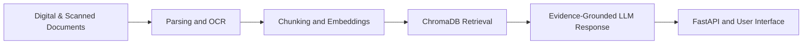

  <h1>Hi, I'm Yash Raj Ravi 👋</h1>
  
<strong>AI & Data Engineering Undergraduate @ IIIT Kota</strong>

  
Applied Machine Learning · RAG Systems · AI Backend Development

  

    
    
    
    
    
  

---
About Me
I'm pursuing a B.Tech in Artificial Intelligence & Data Engineering at IIIT Kota (2024–2028). I enjoy turning ML concepts into usable applications—from predictive-maintenance pipelines to document-grounded question answering systems. I also practice data structures and algorithms through competitive programming.
Current engineering interests:
Building reliable ML pipelines and inference APIs.
Developing RAG applications for domain-specific documents.
Connecting AI backends to practical web interfaces.
Improving problem-solving skills through DSA and contests.
Featured Projects
⚙️ MaintSense — Predictive Maintenance ML System
Traditional ML · FastAPI · React · TypeScript  
View repository
Trained a Random Forest machine-failure classifier using the UCI AI4I 2020 dataset (10,000 records).
Used leakage-aware feature selection, stratified data splits, and a tuned decision threshold of `0.40`.
On the reserved test set, reported 83.67% precision, 70.09% F1-score, and 78.17% average precision. Average precision is threshold-independent; precision and F1 are reported at the selected threshold.
Built a FastAPI inference API and a React + TypeScript dashboard, with input validation, automated tests, and model-artifact integrity checks.
🗺️ Land Acquisition Intelligence Platform
Domain-specific RAG · OCR · Voice AI
Built a grounded question-answering workflow for land-acquisition records using FastAPI, LangChain, ChromaDB, and Ollama.
Added ingestion support for digital and scanned documents using PyMuPDF and Tesseract OCR.
Integrated Sarvam AI for speech-to-text queries and spoken text-to-speech responses.
Focused on evidence-grounded answers and standardized report generation.
🎙️ Multilingual AI Voice Detection
Audio processing · Deep learning · TensorFlow
Developed a human-versus-AI-generated speech classification pipeline covering English, Hindi, Tamil, Telugu, and Malayalam.
Used audio preprocessing and MFCC features to represent acoustic patterns for model training and evaluation.
🛰️ Satellite Image Classification
Computer vision · Transfer learning · ResNet-50
Built a land-use classification pipeline using the EuroSAT dataset with TensorFlow and Keras.
Reported 95% accuracy with frozen pretrained layers, then 98% validation accuracy after fine-tuning the final 30 layers.
💻 Data Structures & Algorithms
C++ · C · Competitive programming
Solved 425+ problems across LeetCode, CodeChef, and Codeforces.
Practice areas include dynamic programming, graphs, trees, two pointers, and bit manipulation.
Codolio portfolio and problem-solving history
RAG Workflow

Technical Skills
Languages  

ML, Deep Learning & RAG  

Backend, UI & Tooling  

Achievements & Certifications
Oracle Agentic AI Certified Foundations Associate
CPS Olympiad: All India Rank 258; State Rank 86
Amazon ML Summer School 2026: Selected for the selection test
ET AI Hackathon 2.0: Selected for the online qualification round
Udemy: Mastering Data Structures & Algorithms using C and C++; Learn C++ Programming – Deep Dive in C++
Connect
GitHub: Yash-Raj-Ravi
LinkedIn: yash-raj-ravi
Email: yrr6735@gmail.com
Codolio: Coding portfolio
---

  Learn by building. Improve by measuring. Ship what you can explain.

