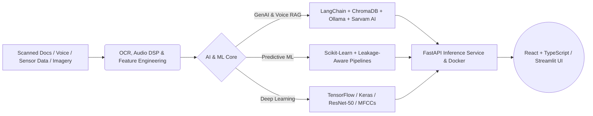

# Hi, I'm Yash Raj Ravi 👋

### 🚀 AI & Data Engineering Undergraduate @ IIIT Kota | RAG & Agentic AI | Full-Stack ML Engineer

[](https://codolio.com/profile/ehPzcOKlg)
[](https://www.linkedin.com/in/yash-raj-ravi-048997323/)
[](mailto:yrr6735@gmail.com)
[](https://leetcode.com/u/YashRajRavi/)
[](https://www.codechef.com/users/yashrajravi)

---

## ⚡ About Me

I'm a B.Tech undergraduate specializing in **Artificial Intelligence & Data Engineering** at the **Indian Institute of Information Technology (IIIT), Kota** (2024–2028). My engineering focus lies at the intersection of **Generative AI**, **Retrieval-Augmented Generation (RAG)**, **Predictive ML Systems**, and **production backend architecture**, backed by strong foundations in **Data Structures & Algorithms**.

```python
class YashRajRavi:
    def __init__(self):
        self.name = "Yash Raj Ravi"
        self.education = "B.Tech in AI & Data Engineering @ IIIT Kota (2024–2028) | CGPA: 7.88"
        self.dsa_milestone = "425+ DSA Problems Solved (LeetCode, CodeChef, Codeforces)"
        self.certifications = [
            "Oracle Agentic AI Certified Foundations Associate",
            "Mastering Data Structures & Algorithms using C and C++",
            "NSP Scholar"
        ]
        self.core_focus = [
            "Domain-Specific RAG, Agentic AI & Voice-Enabled LLM Systems (Ollama, Sarvam AI)",
            "Predictive Maintenance & End-to-End ML Deployment (FastAPI, React, TypeScript)",
            "Multilingual Audio Deep Learning & Geospatial Computer Vision (TensorFlow, Keras)",
            "Algorithmic Problem Solving & Competitive Programming in C++"
        ]
        self.codolio = "[https://codolio.com/profile/ehPzcOKlg](https://codolio.com/profile/ehPzcOKlg)"

    def current_mission(self) -> str:
        return "Architecting grounded, production-grade AI systems from raw unstructured data."
```

---

## 🧠 Core Engineering Domains & Architecture



| Domain | What I Architect & Build | Key Technologies |
| :--- | :--- | :--- |
| **🤖 Generative AI, RAG & Voice AI** | Multi-format OCR document ingestion, grounded RAG question answering, structured report generation, and speech-to-speech LLM interaction. | `LangChain` • `ChromaDB` • `FAISS` • `Ollama` • `Sarvam AI` • `PyMuPDF` • `Tesseract OCR` |
| **⚙️ Predictive ML & Full-Stack Deployment** | Leakage-aware ML pipelines, threshold-tuned classification, RESTful inference microservices, automated testing, and interactive web dashboards. | `FastAPI` • `Scikit-Learn` • `React` • `TypeScript` • `Streamlit` • `Docker` |
| **🔬 Deep Learning, Vision & Audio** | Multilingual speech deepfake detection via MFCC spectral features and transfer learning pipelines for satellite imagery. | `TensorFlow` • `Keras` • `ResNet-50` • `NumPy` • `Pandas` • `NLP` |
| **⚡ Data Structures & Algorithms** | 425+ problems solved across competitive programming platforms focusing on Dynamic Programming, Trees, Graphs, and STL. | `C++` • `C` • `Python` • `LeetCode` • `CodeChef` • `Codeforces` |

---

## 🛠️ Tech Stack & Tooling

### 💻 Programming Languages


### 🧠 Generative AI, Machine Learning & Deep Learning


### 🗄️ Vector Databases, Backend & Frontend


---

## 📌 Featured Projects

| Project & Domain | Key Engineering Highlights & Metrics | Tech Stack |
| :--- | :--- | :--- |
| **🗺️ Land Acquisition Intelligence Platform**<br>*(Domain-Specific RAG, OCR & Voice AI)* | • Built a grounded RAG system for complex land-acquisition records using `FastAPI`, `LangChain`, `ChromaDB`, and `Ollama`.<br>• Implemented multi-format digital and scanned document ingestion with `PyMuPDF` and `Tesseract OCR`, plus automated standardized report generation.<br>• Integrated **Sarvam AI** for end-to-end voice interaction (Speech-to-Text microphone queries & Text-to-Speech spoken LLM responses). | `LangChain`<br>`FastAPI`<br>`ChromaDB`<br>`Ollama`<br>`Tesseract OCR`<br>`PyMuPDF`<br>`Sarvam AI` |
| **⚙️ MaintSense – Predictive Maintenance ML System**<br>*(Full-Stack Industrial ML & React Dashboard)*<br>[**GitHub Repo**](https://github.com/Yash-Raj-Ravi/MaintSense) | • Developed a Random Forest machine-failure classifier on the UCI AI4I 2020 dataset (10,000 records) using leakage-aware feature selection and stratified splits.<br>• Achieved **83.67% precision**, **70.09% F1-score**, and **78.17% average precision** on the reserved test set at a tuned decision threshold of `0.40`.<br>• Deployed a production `FastAPI` inference service and `React` + `TypeScript` dashboard with input validation, automated tests, and model-artifact integrity checks. | `Python`<br>`Scikit-Learn`<br>`FastAPI`<br>`React`<br>`TypeScript` |
| **🎙️ Multilingual AI Voice Detection System**<br>*(Acoustic Deep Learning Classifier)* | • Built a deep learning audio classification pipeline to detect human vs. AI-generated speech across **5 languages**: English, Hindi, Tamil, Telugu, and Malayalam.<br>• Performed audio preprocessing and **MFCC** spectral feature extraction on multilingual voice samples to train and evaluate deep classification models. | `TensorFlow`<br>`Deep Learning`<br>`Audio DSP`<br>`MFCC`<br>`Python` |
| **🛰️ Satellite Image Classification System**<br>*(Geospatial Transfer Learning with ResNet-50)* | • Engineered a satellite land-use classification pipeline using **ResNet-50** on the EuroSAT dataset with `TensorFlow` and `Keras`.<br>• Applied two-stage transfer learning: achieved **95% accuracy** with frozen pretrained layers, then fine-tuned the final 30 layers to boost validation accuracy to **98%**. | `TensorFlow`<br>`Keras`<br>`ResNet-50`<br>`Computer Vision`<br>`Python` |
| **💻 Data Structures & Algorithms Repository**<br>*(425+ Solved Problems in C++ & C)* | • Comprehensive collection of optimized solutions across Dynamic Programming, Graphs, Trees, Two-Pointers, and Bit Manipulation.<br>• Built through consistent problem-solving across **LeetCode**, **CodeChef**, **Codeforces**, and the **Striver A2Z Sheet**. | `C++`<br>`C`<br>`STL`<br>`Algorithms`<br>`DSA` |

---

## 🏆 Achievements, Hackathons & Certifications

- ☁️ **Oracle Certified:** **Oracle Agentic AI Certified Foundations Associate**
- 🥇 **CPS Olympiad:** Secured **All India Rank (AIR) 258** and **State Rank 86**
- ⚡ **Amazon ML Summer School 2026:** Selected for the competitive national selection test *(top 31,820 out of 134,420 registrations)*
- 🚀 **ET AI Hackathon 2.0:** Selected for the online qualification round *(top 9,629 out of 60,974 registrations)*
- 💡 **425+ DSA Problems Solved:** Active competitive programmer across **LeetCode**, **CodeChef**, and **Codeforces**
- 📜 **Additional Certifications:** *Mastering Data Structures & Algorithms using C and C++* (Udemy) • *Learn C++ Programming – Deep Dive in C++* (Udemy)

---

## 📊 Competitive Programming & Codolio Portfolio

[](https://codolio.com/profile/ehPzcOKlg)

| Platform | Handle / Profile Link | Highlights & Focus |
| :--- | :--- | :--- |
| **🌐 Codolio (All-in-One Portfolio)** | [**codolio.com/profile/ehPzcOKlg**](https://codolio.com/profile/ehPzcOKlg) | Unified tracker for 425+ solved problems, contest ratings, heatmaps, and verified certificates |
| **🏆 LeetCode** | [**leetcode.com/u/YashRajRavi**](https://leetcode.com/u/YashRajRavi/) | Data Structures, Algorithms, Dynamic Programming, Graphs & Trees |
| **⚔️ CodeChef** | [**codechef.com/users/yashrajravi**](https://www.codechef.com/users/yashrajravi) | Rated Competitive Programming Contests in C++ |

---

## 📫 Connect With Me

- 📧 **Email:** [yrr6735@gmail.com](mailto:yrr6735@gmail.com)
- 💼 **LinkedIn:** [linkedin.com/in/yash-raj-ravi-048997323](https://www.linkedin.com/in/yash-raj-ravi-048997323/)
- 📊 **Codolio:** [codolio.com/profile/ehPzcOKlg](https://codolio.com/profile/ehPzcOKlg)

---

> *"Learning is useful. Building is what proves it."*
