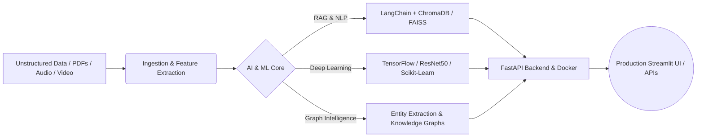

# Hi, I'm Yash Raj Ravi 👋

### 🚀 AI & Data Engineering Undergraduate @ IIIT Kota | RAG & LLM Systems | Competitive Programmer

[](https://codolio.com/profile/ehPzcOKlg)
[](https://www.linkedin.com/in/yash-raj-ravi-048997323/)
[](mailto:yrr6735@gmail.com)
[](https://leetcode.com/u/YashRajRavi/)
[](https://www.codechef.com/users/yashrajravi)

---

## ⚡ About Me

I'm a B.Tech undergraduate specializing in **Artificial Intelligence & Data Engineering** at **IIIT Kota** (2024–2028). My engineering focus lies at the intersection of **Generative AI**, **Retrieval-Augmented Generation (RAG)**, and **scalable backend architecture**, paired with a strong foundation in **Data Structures & Algorithms**.

```python
class YashRajRavi:
    def __init__(self):
        self.name = "Yash Raj Ravi"
        self.education = "B.Tech in AI & Data Engineering @ IIIT Kota (2024–2028)"
        self.recognition = "NSP Scholar (National Scholarship Portal Awardee)"
        self.dsa_milestone = "300+ Striver A2Z & LeetCode Problems Solved (C++)"
        self.core_focus = [
            "Retrieval-Augmented Generation (RAG) & Knowledge Graphs",
            "End-to-End LLM Applications & Modern NLP Pipelines",
            "Deep Learning, Computer Vision & Audio Signal Processing",
            "Scalable AI Microservices with FastAPI & Docker"
        ]
        self.codolio = "[https://codolio.com/profile/ehPzcOKlg](https://codolio.com/profile/ehPzcOKlg)"

    def current_mission(self) -> str:
        return "Transforming complex unstructured data into intelligent, source-cited AI systems."
```

---

## 🧠 Core Engineering Domains & Architecture



| Domain | What I Architect & Build | Key Technologies |
| :--- | :--- | :--- |
| **🤖 Generative AI & RAG Systems** | Multi-document ingestion, chunking strategies, semantic vector retrieval, source-cited Q&A, and entity-relationship extraction. | `LangChain` • `OpenAI API` • `Hugging Face` • `ChromaDB` • `FAISS` • `PyMuPDF` |
| **🔬 Deep Learning & Computer Vision** | Transfer learning pipelines, convolutional architectures, audio feature classification, and custom NLP workflows. | `TensorFlow` • `ResNet50` • `Scikit-Learn` • `NLP` • `Audio Signal Processing` |
| **⚙️ Backend & AI Deployment** | RESTful API design for ML inference, containerization, interactive data dashboards, and production web integrations. | `FastAPI` • `Docker` • `Streamlit` • `SQL` • `Git & GitHub` |
| **⚡ Data Structures & Algorithms** | Competitive programming and algorithmic optimization across graphs, trees, dynamic programming, and bit manipulation. | `C++ STL` • `Codolio` • `LeetCode` • `CodeChef` • `Striver A2Z` |

---

## 🛠️ Tech Stack & Tooling

### 💻 Programming Languages


### 🧠 AI, Machine Learning & NLP


### 🗄️ Vector Databases, Backend & DevOps


---

## 📌 Featured Projects

| Project & Architecture | Key Engineering Highlights | Tech Stack |
| :--- | :--- | :--- |
| **🏭 Industrial Knowledge Intelligence Platform**<br>*(Multi-Document RAG & Knowledge Graphs)* | • Built multi-document OCR & PDF ingestion pipelines using `PyMuPDF`.<br>• Engineered a semantic search & source-cited Q&A engine backed by `ChromaDB` and `LangChain`.<br>• Automated entity extraction to generate **Knowledge Graphs** linking machinery, reports, and maintenance procedures.<br>• Exposed inference APIs via `FastAPI` with an interactive `Streamlit` operator dashboard. | `LangChain`<br>`FastAPI`<br>`ChromaDB`<br>`PyMuPDF`<br>`Streamlit`<br>`LLMs` |
| **🛰️ Satellite Image Classification (ResNet50)**<br>*(Geospatial Deep Learning Pipeline)* | • Designed an end-to-end transfer learning pipeline using **ResNet50** on the EuroSAT dataset.<br>• Applied custom data augmentation, learning-rate scheduling, and layer fine-tuning across 10 terrain classes.<br>• Achieved **98.02% validation accuracy** on benchmark evaluation. | `TensorFlow`<br>`ResNet50`<br>`Python`<br>`CNN`<br>`Deep Learning` |
| **📺 YouTube RAG Chatbot**<br>*(Conversational Video Transcript AI)* | • Automated extraction, cleaning, and semantic chunking of long-form YouTube video transcripts.<br>• Indexed dense vector embeddings in `FAISS` / `ChromaDB` for sub-second similarity retrieval.<br>• Built context-aware `LangChain` chains that answer user questions strictly grounded in video content. | `LangChain`<br>`Vector DB`<br>`Embeddings`<br>`LLMs`<br>`Streamlit` |
| **🎙️ AI Voice Detection System**<br>*(Acoustic Deepfake Classifier)* | • Extracted spectral and temporal audio signatures (MFCCs, spectral centroid, chroma) from raw waveforms.<br>• Trained supervised classification models to distinguish authentic human speech from AI-synthesized audio. | `Scikit-Learn`<br>`Audio DSP`<br>`Python`<br>`Machine Learning` |
| **💻 Data Structures & Algorithms Repository**<br>*(300+ Solved Problems in C++)* | • Curated collection of optimized C++ solutions across Dynamic Programming, Trees, Graphs, Two-Pointers, and Bit Manipulation.<br>• Built through consistent daily problem-solving on **LeetCode** and the **Striver A2Z DSA Sheet**. | `C++17 / C++20`<br>`STL`<br>`Algorithms`<br>`DSA` |

---

## 📊 Competitive Programming & Codolio Portfolio

[](https://codolio.com/profile/ehPzcOKlg)

| Platform | Handle / Profile Link | Highlights & Focus |
| :--- | :--- | :--- |
| **🌐 Codolio (All-in-One Tracker)** | [**codolio.com/profile/ehPzcOKlg**](https://codolio.com/profile/ehPzcOKlg) | Unified dashboard tracking all DSA problems, contest ratings, heatmaps, and GitHub activity |
| **🏆 LeetCode** | [**leetcode.com/u/YashRajRavi**](https://leetcode.com/u/YashRajRavi/) | 300+ DSA Problems Solved (Striver A2Z Sheet, Dynamic Programming, Trees, Graphs) |
| **⚔️ CodeChef** | [**codechef.com/users/yashrajravi**](https://www.codechef.com/users/yashrajravi) | Competitive Programming & Rated Algorithmic Contests in C++ |

---

## 🎯 Current Technical Focus

- **Advanced RAG Architectures:** Hybrid dense + sparse retrieval, cross-encoder re-ranking, and GraphRAG
- **LLM Microservices:** Asynchronous API design with **FastAPI**, containerization with **Docker**, and vector database scaling
- **Deep Learning & NLP:** Transformer fine-tuning, multi-modal pipelines, and domain-specific embeddings
- **Competitive Programming:** Advanced Dynamic Programming & Graph Algorithms in **C++**

---

## 📫 Connect With Me

- 📧 **Email:** [yrr6735@gmail.com](mailto:yrr6735@gmail.com)
- 💼 **LinkedIn:** [linkedin.com/in/yash-raj-ravi-048997323](https://www.linkedin.com/in/yash-raj-ravi-048997323/)
- 📊 **Codolio:** [codolio.com/profile/ehPzcOKlg](https://codolio.com/profile/ehPzcOKlg)

---

> *"Learning is useful. Building is what proves it."*
